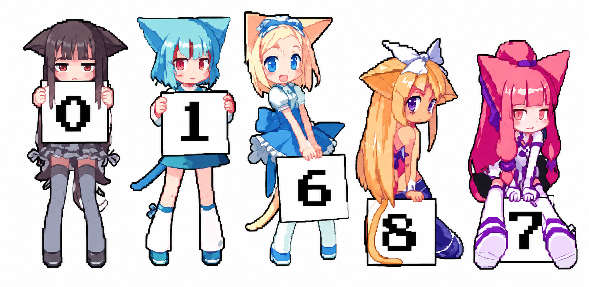

  
  <h1>
    💻 Hi, I'm <a href="https://github.com/vipulbhamare09-blip" style="text-decoration: none; color: #58A6FF;">Vipul!</a>
  </h1>
  

    
    &nbsp;
    
    &nbsp;
    
    &nbsp;
    
  

  
    
  
   
  
   
  
   
  
   
  
    
  

---

<h2 align="center">⚔ Languages-Frameworks-Tools ⚔</h2>
 

  
    
  
    
  

 

<h4 align="center">made with  by <a href="https://github.com/vipulbhamare09-blip" style="color: #58A6FF; text-decoration: none;">Vipul Bhamare</a></h4>
