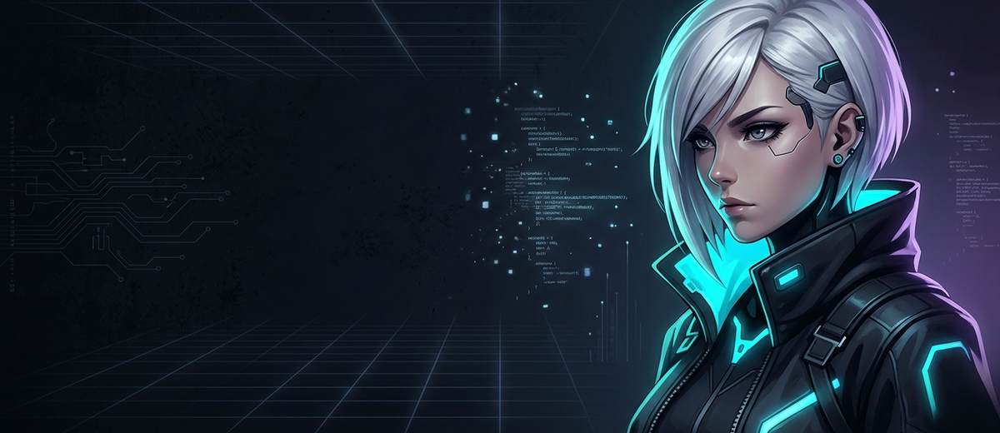

  
  <h1>
    💻 Hi, I'm <a href="https://github.com/vipulbhamare09-blip" style="text-decoration: none; color: #58A6FF;">Vipul!</a>
  </h1>
  

    
    &nbsp;
    
    &nbsp;
    
    &nbsp;
    
  

### About me

<table style="width: 100%; border: none;">
  <tr style="border: none; background: transparent;">
    <td style="width: 78%; vertical-align: top; padding: 0; border: none; background: transparent;">
      <table style="width: 100%; margin: 0;">
        <tr><td>🎓 <a href="https://www.vupune.ac.in/"><b>Vishwakarma University</b></a> • B.Tech CSE / AI &amp; Autonomous Systems</td></tr>
        <tr><td>📍 <b>Location:</b> Pune, Maharashtra, India</td></tr>
        <tr><td>🤖 <b>Specialization:</b> Autonomous Robotics • Applied AI / ML • Embedded IoT Systems</td></tr>
        <tr><td>⚙️ <b>Core Project:</b> <a href="https://github.com/vipulbhamare09-blip/Wilo-Water-Pump-Automation-1"><b>Wilo AI Water Transfer System</b></a> (LoRa SX1278 • ESP32 • RPi 4 • ADS1115 • ACS712 • ML Schedule)</td></tr>
        <tr><td>🌾 <b>Initiatives:</b> <a href="https://github.com/vipulbhamare09-blip/SmartFarmAI"><b>SmartFarmAI</b></a> (AI for Bharat) • <a href="https://github.com/vipulbhamare09-blip/Team-Vipkshayush---EightFold-AI-Hackathon"><b>EightFold AI Hackathon</b></a></td></tr>
        <tr><td>💻 <b>Currently Building:</b> Autonomous Flight Sim &amp; Drone Telemetry (ROS 2 • Gazebo)</td></tr>
        <tr><td>🐧 <b>Environment:</b> Linux / Ubuntu • VS Code • Git / GitHub CLI</td></tr>
        <tr><td>💙 <b>Love to:</b> Code • Build Hardware Automations • Simulate Robotics</td></tr>
        <tr><td>🌐 <b>Languages:</b> English • Hindi • Marathi</td></tr>
      </table>
    </td>
    <td style="width: 22%; text-align: center; vertical-align: middle; padding: 10px; border: none; background: transparent;">
      
    </td>
  </tr>
</table>

 

    
  
   
  
   
  
   
  
   
  
   
  

 

---

<h2 align="center">⚔ Languages-Frameworks-Tools ⚔</h2>
 

  
    
  
    
  

 

<h4 align="center">made with  by <a href="https://github.com/vipulbhamare09-blip" style="color: #58A6FF; text-decoration: none;">Vipul Bhamare</a></h4>
