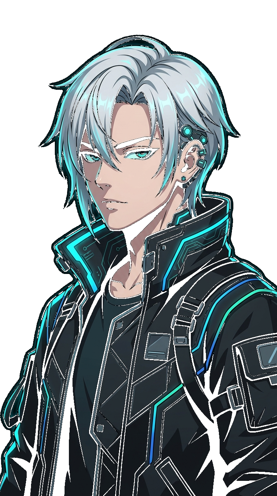
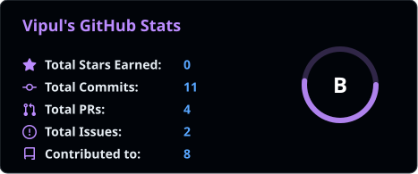
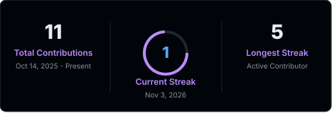
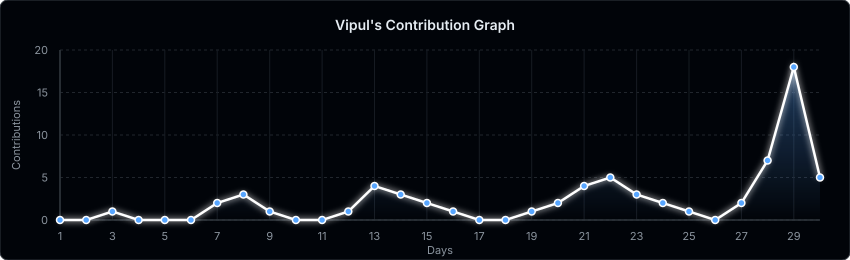

  
  <h1>
    💻 Hi, I'm <a href="https://github.com/vipulbhamare09-blip" style="text-decoration: none; color: #58A6FF;">Vipul!</a>
  </h1>
  

    
    &nbsp;
    
    &nbsp;
    
    &nbsp;
    
  

### About me

| 
🎓 <a href="https://www.vupune.ac.in/"><b>Vishwakarma University</b></a> • B.Tech CSE / AI &amp; Autonomous Systems 
 |
| ------------------------------------------------------------------------------------------------------------------------------------------------------------- |
| 📍 **Location:** Pune, Maharashtra, India |
| 🤖 **Specialization:** Autonomous Robotics • Applied AI / ML • Embedded IoT Systems |
| ⚙️ **Core Project:** [Wilo AI Water Transfer System](https://github.com/vipulbhamare09-blip/Wilo-Water-Pump-Automation-1) (LoRa SX1278 • ESP32 • RPi 4 • ADS1115 • ACS712 • ML Schedule) |
| 🌾 **Initiatives:** [SmartFarmAI](https://github.com/vipulbhamare09-blip/SmartFarmAI) (AI for Bharat) • [EightFold AI Hackathon](https://github.com/vipulbhamare09-blip/Team-Vipkshayush---EightFold-AI-Hackathon) |
| 💻 **Currently Building:** Autonomous Flight Sim &amp; Drone Telemetry (ROS 2 • Gazebo) |
| 🐧 **Environment:** Linux / Ubuntu • VS Code • Git / GitHub CLI |
| 💙 **Love to:** Code • Build Hardware Automations • Simulate Robotics |
| 🌐 **Languages:** English • Hindi • Marathi |

 

    
  
   
  
   
  
   
  
   
  
   
  

 

---

<h2 align="center">⚔ Languages-Frameworks-Tools ⚔</h2>
 

  
    
  
    
  

 

<h4 align="center">made with  by <a href="https://github.com/vipulbhamare09-blip" style="color: #58A6FF; text-decoration: none;">Vipul Bhamare</a></h4>
